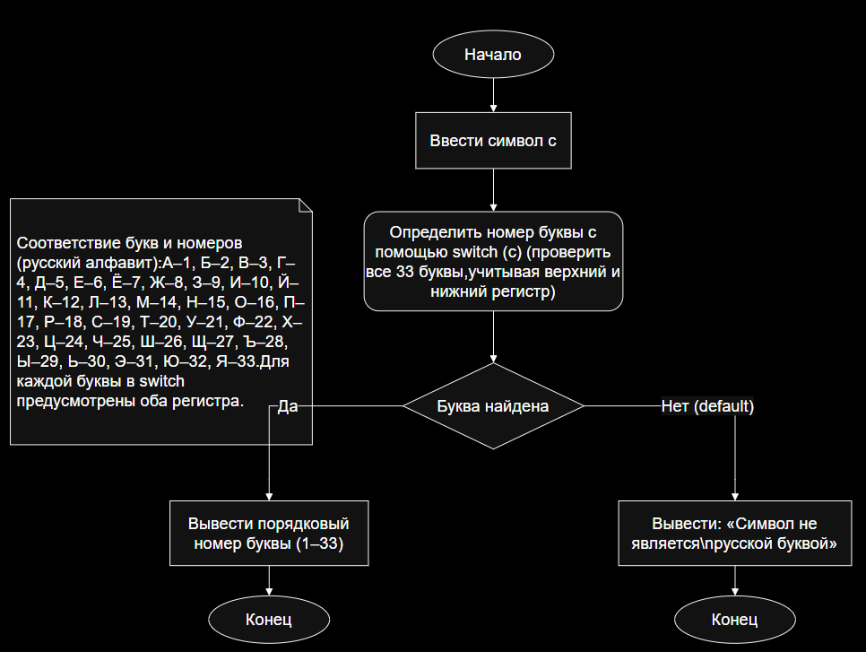

# Домашняя работа 7
# Вариант 23 
# Условие
### Составить программу, которая определяет порядковый номер введенной буквы в алфавите




#
```c
int main() {
    SetConsoleCP(65001);
    SetConsoleOutputCP(65001);
    setlocale(LC_ALL, "Russian");
    homework();
    return 0;
}
int homework() {
    char c;
    printf("Введите букву русского алфавита:\n");
    scanf(" %c", &c);
    switch (c) {
    case 'а': case 'А':
        printf("Порядковый номер: 1\n");
        break;
    case 'б': case 'Б':
        printf("Порядковый номер: 2\n");
        break;
    case 'в': case 'В':
        printf("Порядковый номер: 3\n");
        break;
    case 'г': case 'Г':
        printf("Порядковый номер: 4\n");
        break;
    case 'д': case 'Д':
        printf("Порядковый номер: 5\n");
        break;
    case 'е': case 'Е':
        printf("Порядковый номер: 6\n");
        break;
    case 'ё': case 'Ё':
        printf("Порядковый номер: 7\n");
        break;
    case 'ж': case 'Ж':
        printf("Порядковый номер: 8\n");
        break;
    case 'з': case 'З':
        printf("Порядковый номер: 9\n");
        break;
    case 'и': case 'И':
        printf("Порядковый номер: 10\n");
        break;
    case 'й': case 'Й':
        printf("Порядковый номер: 11\n");
        break;
    case 'к': case 'К':
        printf("Порядковый номер: 12\n");
        break;
    case 'л': case 'Л':
        printf("Порядковый номер: 13\n");
        break;
    case 'м': case 'М':
        printf("Порядковый номер: 14\n");
        break;
    case 'н': case 'Н':
        printf("Порядковый номер: 15\n");
        break;
    case 'о': case 'О':
        printf("Порядковый номер: 16\n");
        break;
    case 'п': case 'П':
        printf("Порядковый номер: 17\n");
        break;
    case 'р': case 'Р':
        printf("Порядковый номер: 18\n");
        break;
    case 'с': case 'С':
        printf("Порядковый номер: 19\n");
        break;
    case 'т': case 'Т':
        printf("Порядковый номер: 20\n");
        break;
    case 'у': case 'У':
        printf("Порядковый номер: 21\n");
        break;
    case 'ф': case 'Ф':
        printf("Порядковый номер: 22\n");
        break;
    case 'х': case 'Х':
        printf("Порядковый номер: 23\n");
        break;
    case 'ц': case 'Ц':
        printf("Порядковый номер: 24\n");
        break;
    case 'ч': case 'Ч':
        printf("Порядковый номер: 25\n");
        break;
    case 'ш': case 'Ш':
        printf("Порядковый номер: 26\n");
        break;
    case 'щ': case 'Щ':
        printf("Порядковый номер: 27\n");
        break;
    case 'ъ': case 'Ъ':
        printf("Порядковый номер: 28\n");
        break;
    case 'ы': case 'Ы':
        printf("Порядковый номер: 29\n");
        break;
    case 'ь': case 'Ь':
        printf("Порядковый номер: 30\n");
        break;
    case 'э': case 'Э':
        printf("Порядковый номер: 31\n");
        break;
    case 'ю': case 'Ю':
        printf("Порядковый номер: 32\n");
        break;
    case 'я': case 'Я':
        printf("Порядковый номер: 33\n");
        break;
    default:
        printf("Введённый символ не является русской буквой!\n");
        break;
    }
    return 0;
}
```
